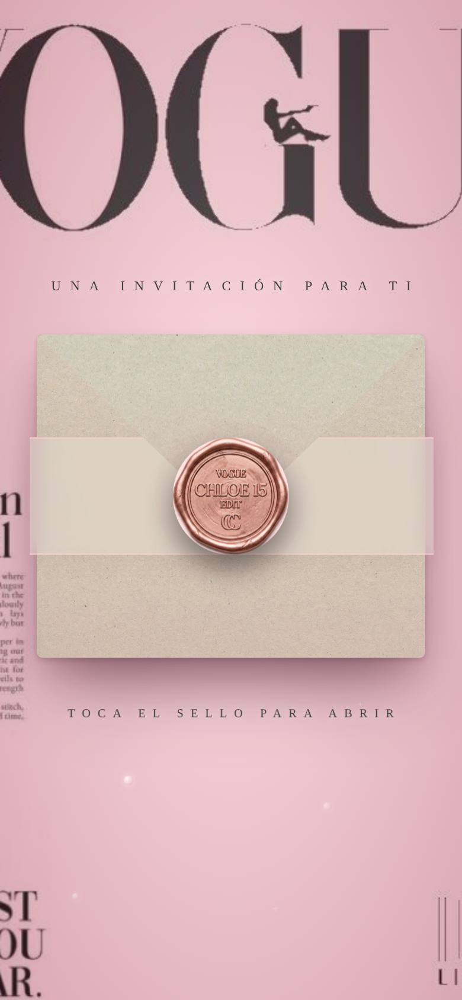
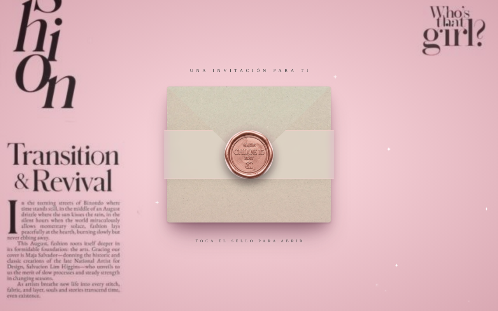

# Vogue XV Edition · Invitación digital editorial

Invitación web para XV años inspirada en el lenguaje visual de una revista de moda: portada tipográfica, sello de cera interactivo y secciones con ritmo editorial. Es uno de los modelos de **Mirai**.

<p align="center">
  
  &nbsp;&nbsp;
  
</p>

## El reto de diseño

Llevar la estética de una portada de revista (tipografía display enorme, mucho aire, jerarquía fuerte) a una pantalla de 390 px sin perder legibilidad, y que la invitación se sienta premium desde el primer toque.

## Qué resolví

- **Apertura interactiva:** sobre en 3D con solapa que gira, carta que sube y sello de cera con pulso y brillo. La música arranca al tocar el sello, porque los navegadores bloquean el autoplay.
- **Sistema de diseño en tokens:** colores, tipografías, espacios, duraciones y curvas de animación viven en `variables.css`, así un cambio de tema no toca el resto del CSS.
- **Animación con intención:** revelado al hacer scroll con `IntersectionObserver`, cuenta regresiva con animación en cada segundo y parallax suave.
- **Contenido configurable:** nombre, fecha, lugar y WhatsApp salen de un objeto `CONFIG`. Fechas del calendario, del enlace a Google Calendar y de los pases se calculan desde una sola fecha.
- **Mobile-first:** pensada primero para celular, porque ahí se abren casi todas las invitaciones.

## Secciones

Portada · Bienvenida · Fotos · Cuenta regresiva · Calendario · Historia editorial · Código de vestimenta · Regalos · Confirmación por WhatsApp · Extras

## Stack

HTML5 · CSS3 (custom properties, 3D transforms, clip-path) · JavaScript vanilla · Netlify

## Estructura

```
css/   variables → layout → components → envelope → animations → premium → responsive
js/    script.js (CONFIG, sobre, cuenta regresiva, calendario, reveal, música)
assets/
```

---

Diseñado y desarrollado por **Adair Kevin** · Mirai
